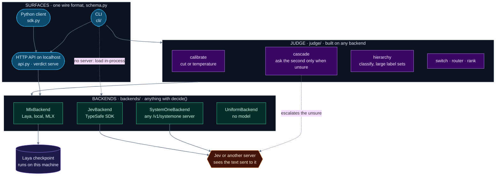

# verdict

Fast, local answers to typed questions about text: yes/no, pick one, or a level, each with a
probability, in about 30 ms of model time (a tenth of a second a call against a running server)
on Apple Silicon. Nothing is generated and nothing is run on
your behalf. verdict answers; you, or your agent, act.

Use it when the same judgment has to be made over hundreds or thousands of short texts (commands,
tickets, messages, agent turns) and a person or an LLM should read only what it flags.

Laya runs on your machine and sends nothing out. When a task needs a stronger model, TypeSafe's Jev
can answer instead (`verdict serve --systemone`), or only for the answers Laya is least sure of
(`verdict cascade`); both say what they send. [What each is good at](docs/usage/models.md), and
[where Laya is rough](docs/usage/rough-edges.md), are measured, not asserted.

## Quick start

Apple Silicon, Python 3.11.

```sh
uv tool install --python 3.11 'verdict[mlx,laya] @ git+https://github.com/iksnerd/verdict.git@v0.10.1'
verdict init        # picks a free port and writes ~/.config/verdict/config.toml
verdict serve &     # holds the model, so each call costs milliseconds

verdict ask "commit the fix and push it" "Is this an instruction to perform an action?"
# 0.94
verdict ask "why does the build fail on CI" "Is this an instruction to perform an action?"
# 0.05

kill $(lsof -ti TCP:8799 -sTCP:LISTEN)   # holds the model in GPU memory; stop it when done
                                          # (8799 unless `verdict config` shows another url)
```

The model, [Laya](https://huggingface.co/convaiinnovations/laya) (`aac6fef/laya-mlx`,
Apache-2.0), downloads itself on first use. `verdict update` moves to the newest release.

A yes/no comes back as P(yes), and 0.5 is not the line between yes and no: Laya's scores are shifted,
and a cut fitted on your own labelled examples (`verdict calibrate labelled.jsonl -q bank.json --out
fit.json`, then `--cut fit.json`) took accuracy from 0.81 to 0.86 on five public suites
([FINDINGS §55](docs/research/FINDINGS.md)).

The same thing from Python, with typed questions and a result grouped by type:

```python
from verdict import Verdict, Noul

with Verdict() as v:                       # the server `verdict serve` started
    r = v.decide({"text": "commit the fix and push it"},
                 {"act": Noul(instructions="Is `text` an instruction to perform an action?")})
    r.nouls["act"].noul                    # 0.98
```

Hosted Jev is optional. Add TypeSafe's SDK by reinstalling with the `jev` extra, and let
`TYPESAFE_API_KEY` supply the key:

```sh
uv tool install --force --python 3.11 'verdict[mlx,laya,jev] @ git+https://github.com/iksnerd/verdict.git@v0.10.1'
```

verdict is installed from GitHub, not PyPI: the name `verdict` there is an unrelated project, so
`pip install verdict` gets the wrong software. Nothing leaves your machine unless you choose a
command that says it will.

## When it is the right tool

It fits a task with many items, short texts, a question about what the text shows, a yes/no or a
few named options, and a need for a number to rank or cut on, or for data to stay on the machine.
On public labelled sets the default model ranks sentiment at 0.97, spam at 0.98 and prompt
injection at 0.93 AUC (the 0.9.0 release scorecard, 200 items each; method in
[FINDINGS §40](docs/research/FINDINGS.md)).

It is the wrong tool for categories that need world knowledge (seven commit types: 0.44 accuracy,
where an LLM does better) or a maintainer's judgment (bug report or support question: 0.59, and two
rounds of fine-tuning did not fix it; [FINDINGS §41, §45](docs/research/FINDINGS.md)). It is also a
weak fit for a very large flat choice (Banking77's 77 options: 0.38; a tree or an embedding model
does better there, but not everywhere, see below), for long
documents (it reads the first 128 tokens), for comparing numbers
(which of four decks has the highest mean: chance, where "is this one negative" is perfect;
[§46](docs/research/FINDINGS.md)), and for questions about consequences or difficulty, which score at
chance. verdict refuses those questions rather than answer them badly, refuses more than 20 options
as a conservative default (`--allow-unmeasured` overrides it), and warns when a text runs past what
it reads.

## Features

- **Three question types:** `ask` inline, `decide` with a JSON bank of questions. A yes/no gives
  P(yes), a choice a probability per option, a score an expected level.
- **Bulk runs:** `decide --jsonl` streams one bank over any number of states and flags a question
  whose answers barely vary.
- **Calibration:** `calibrate` fits a cut or a temperature on your own labels and reports it on a
  held-out split.
- **Measured questions by name:** `verdict questions` lists questions with their measured results;
  `-q is_instruction,work_finished` uses them.
- **Guard rails:** question shapes that measured at chance, choices of more than 20 options (a default,
  not a measured cliff), and questions about a field the
  state does not have, are refused (`--allow-unmeasured` asks anyway), and `validate` checks a bank
  with no model loaded.
- **Built for scripts and agents:** every error is one `verdict:` line and exit 2, and under
  `--json`/`--jsonl` also `{"error": {"code", "message"}}` on stdout, with codes to branch on.
  `--jsonl` rows carry the `index` of the input line they answer. A typo gets a "did you mean",
  and `verdict config` shows each setting and where it came from.
- **Search by named answers:** `rank` orders a `decide --jsonl` run by a weighted sum of its
  answers and shows what each one contributed.
- **Other languages:** `--lang multi` switches to Laya's multilingual checkpoint.
- **An HTTP API** on localhost ([docs/usage/api.md](docs/usage/api.md)) that answers as the CLI does, with
  the same refusals and the same numbers (a refusal is a 422 carrying `error.code` `refused`),
  including TypeSafe Jev's `/v1/systemone` protocol, so Jev's SDKs work against it.
- **Backend capabilities:** `GET /v1/capabilities` reports Laya/Jev limits and confidence
  semantics separately from the shared protocol ([SDK guide](docs/usage/api.md#discovering-backend-differences)).
- **A Python API shaped like TypeSafe's SDK:** `from verdict import Verdict, Noul, Choice, Score`.
  Typed questions, a result with `.nouls`, `.choices` and `.scores`, a sync `with` client and one
  error type with a `.status`; the same refusals as the CLI and the HTTP API
  ([docs/usage/api.md](docs/usage/api.md#the-python-client-verdict)).
- **Swap the backend:** `[model.extra]` names further local laya checkpoints;
  `verdict serve --systemone URL` (or `[systemone]` in the config) answers with any other
  `/v1/systemone` server instead, TypeSafe's Jev included (key in `$TYPESAFE_API_KEY`; every state
  is sent there; hosted Jev goes through TypeSafe's SDK, the `jev` extra above). It is a
  real, differently-trained model, not another laya checkpoint. `verdict examples --systemone URL`
  checks it against the same real inputs `examples/README.md` documents for Laya, with a match
  count and ms/call, not one-off questions.
- **Laya first, Jev for the unsure:** `verdict cascade -q BANK --escalate URL` answers everything
  locally and re-asks a second server about the least-sure answers only. On prompt injection,
  sending 30% matched Jev alone (0.845 against Laya's 0.805); `--check` tells you per task whether
  it helps, and says so when it would not (AG News). Fitting the yes/no cut (`--fit`, `--calibration`)
  lifts Laya alone from 0.81 to 0.86 on five bench suites and makes the cascade pick better.
  Every escalated text leaves the machine ([FINDINGS §52, §54, §55](docs/research/FINDINGS.md)).
- **Many options:** `verdict classify TEXT --tree FILE` walks a two-level tree and reports the group scores it
  used (`group_probabilities`, `searched_groups`). On Banking77
  (77 intents) it took base Laya from 0.38 flat to 0.55 ([FINDINGS §50](docs/research/FINDINGS.md)); the tree
  is `examples/banking-tree/tree.json`. It does not always help: on CLINC150 (150 distinct intents)
  one flat choice scored 0.56 and the trees 0.31 to 0.49, mostly losing at the group stage
  ([§58, §59](docs/research/FINDINGS.md)), so compare
  on a labelled sample. For topical labels an embedding model does better still
  (0.89 on the same items, FINDINGS §53); Laya is a judge of typed facts, not a retriever.
- **The docs ship with the tool:** `verdict docs`, `verdict docs concepts`, `verdict docs guide`,
  `verdict docs findings N`, and three short pages in the shape of TypeSafe's: [patterns](docs/usage/patterns.md) (fan-out,
  confidence routing, composite scoring, intent routing), [rough edges](docs/usage/rough-edges.md) (where
  Laya fails, with the measurement) and [models](docs/usage/models.md) (which checkpoint, or Jev, for what).

## How it works

Laya is a ModernBERT encoder trained to answer typed questions in one forward pass, run through
MLX. `verdict serve` loads it once; without a server, each command loads it itself. Every question
costs one pass over the state, so a bank should hold only the questions you need. The scores are
uncalibrated: trust their order, and fit a cut before gating anything on one.

What asks what, from the three surfaces down to the model ([source](docs/design/architecture.mmd)):



Laya judges typed facts about a text. It is not a retriever: matching a text to one of many topical
labels is better done by an embedding model (FINDINGS §53). The surfaces are one core: the CLI, a
localhost HTTP API that also speaks TypeSafe's Jev protocol, and the Python client. A backend is
anything with `decide`: local Laya, hosted Jev through TypeSafe's SDK, or another `/v1/systemone`
server.

## For agents

A Claude Code plugin in this repo teaches an agent when to reach for verdict and how to read the
numbers:

```sh
claude plugin marketplace add iksnerd/verdict
claude plugin install verdict@verdict
```

## Documentation

Using verdict (`docs/usage/`):

- [concepts.md](docs/usage/concepts.md): what a state, a question, an answer and a bank are.
- [guide.md](docs/usage/guide.md): writing questions, bulk runs, calibration, recipes,
  troubleshooting, and the command reference.
- [api.md](docs/usage/api.md): the HTTP API, the Python client and the backends.
- [patterns.md](docs/usage/patterns.md), [rough-edges.md](docs/usage/rough-edges.md) and
  [models.md](docs/usage/models.md): what to build with typed answers, where Laya fails, and which
  model for what. `verdict docs patterns | rough-edges | models` prints them.
- [examples/](examples/README.md): fifteen runnable banks, a tree for `classify` and a Python
  script, with invented inputs and their real measured output, including what each one gets wrong.

How it is built (`docs/design/`):

- [pipeline.md](docs/design/pipeline.md): building a checkpoint.
- [defaults.md](docs/design/defaults.md): the defaults verdict keeps, why, and how to override each
  (`verdict docs defaults`).
- [routing.md](docs/design/routing.md): the big-or-small model switch, kept as a worked example of
  why a routing question can sit at chance.

Evidence:

- [FINDINGS.md](docs/research/FINDINGS.md): every measurement behind these docs, with sample sizes
  and intervals.

## Developing

```sh
uv sync --extra mlx --extra laya --extra jev   # plain `uv sync` drops the extras and breaks the CLI
                                                # (jev is TypeSafe's SDK; its tests skip without it)
uv run pytest                        # no network and no model needed
git config core.hooksPath .githooks  # pre-commit: blocked paths, gitleaks, tests on the staged snapshot
```

A release is a `vX.Y.Z` tag with a committed answer-quality scorecard (`verdict bench`, 12 pinned
public suites); CI refuses a tag whose scorecard is missing or below the previous one.

Apache-2.0. See [LICENSE](LICENSE) and [NOTICE](NOTICE).
